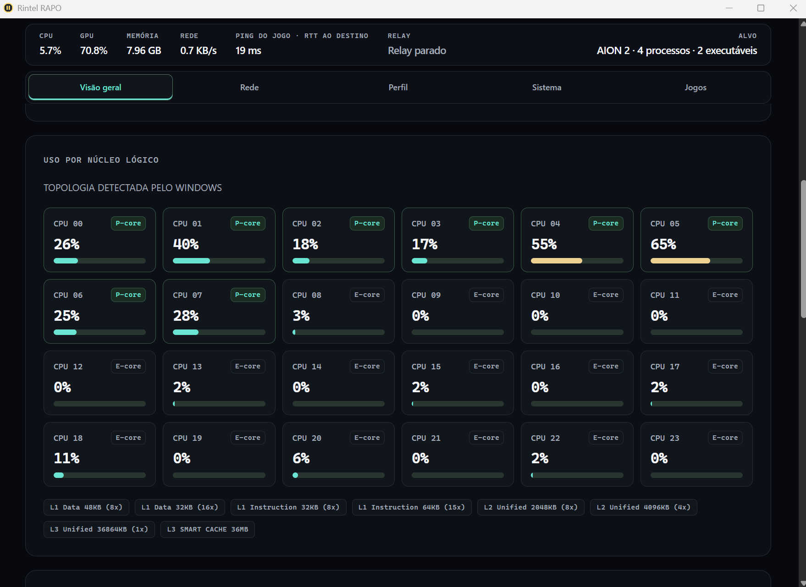

# Rintel RAPO

[](https://github.com/wwwwelton/rintel-rapo/actions/workflows/release.yml)
[](https://github.com/wwwwelton/rintel-rapo/releases)
[]()
[]()

Aplicativo para **Windows 11 x64** para detectar jogos Steam em execução e aplicar, **por opção do usuário**, ajustes de prioridade e afinidade. Não é o Intel Application Optimization (APO), não contém código do APO e não altera firmware, clock ou cache L1/L2/L3.



## Funcionalidade e limites

- **Auto Prioridade:** eleva a classe do processo para acima do normal enquanto o jogo está em foco; restaura a classe original ao parar. O modo «Manter ajustes em segundo plano» também o faz fora de foco e pode prejudicar outros aplicativos.
- **Afinidade CPU (`CriticalThreadsAffinitize`):** o ajuste manual P-cores fixa por padrão até 4 threads críticas nos núcleos de maior classe de eficiência reportados pelo Windows (limiar de utilização de 5%, estabilidade de 20%, intervalo de 10 s para `AION2.exe`). O RAPO também testa quantidades de núcleos físicos, todos os núcleos versus apenas P-cores em CPUs híbridas, quantidade de threads críticas e irmãos SMT/Hyper-Threading. Em CPUs homogêneas, testa afinidade e SMT nos núcleos disponíveis. Não substitui afinidade escolhida pelo jogo; o Auto-Yield cede a alterações externas. Mudar de candidato reaplica a nova máscara sem manter silenciosamente a anterior.
- **Prioridade de memória / EcoQoS:** define prioridade de páginas de memória 5 e desativa a marca de execução EcoQoS para o processo selecionado. Salva e tenta restaurar os valores anteriores ao desativar ou fechar o aplicativo, sem sobrescrever alterações externas detectadas. Não controla o cache da CPU nem a fila NVMe.
- **Perfil APO UE5 (AION 2):** integrado diretamente às opções **Auto Prioridade**, **P-cores** e **Prioridade de memória / EcoQoS** (ou pelo atalho **Perfil APO** na linha do jogo). Com o jogo fechado, lê `AION2.exe` e índices `.utoc`; se ainda houver orçamento, aquece contêineres `.ucas` em ordem de tamanho. O orçamento é recalculado em tempo real como 25% da RAM física disponível, limitado a 512 MiB–4 GiB, e cai quando a memória fica pressionada. A leitura para ao iniciar o jogo ou desativar o perfil. O cache é compartilhado e evictável pelo Windows; não é uma cópia privada nem uma garantia de permanência em RAM. Em execução, aplica `CriticalThreadsAffinitize=4` (limiar 5%, intervalo 10 s, E-cores livres), sem hook, sem DLL e sem escrita em MSR.
- **Telemetria:** CPU, GPU, RAM e contadores de leitura I/O do processo selecionado; tráfego de rede e leitura do disco físico referem-se ao **sistema inteiro**. O **Ping do jogo** é o menor RTT ICMP com resposta entre os IPs com conexão TCP estabelecida do processo do jogo; sem jogo, sem conexão TCP ou sem resposta, o painel diz isso em vez de mostrar um número. Não há mais sonda a DNS público. Nenhuma dessas métricas identifica ou garante o ping do servidor de partida. Valores podem estar indisponíveis quando o Windows não expõe contadores ou a rede bloqueia as sondas.
- **Bandeja:** permite iniciar/parar a otimização e minimizar a interface sem interromper o monitoramento.
- **Administrador (opcional):** em «Opções e diretrizes de agendamento», «Reabrir como administrador» solicita UAC e reinicia o aplicativo elevado. Se cancelar, a janela atual permanece aberta. Após reiniciar, selecione os ajustes novamente; elevar pode permitir acesso a processos comuns, mas não contorna proteções de anti-cheat.
- **RAPO ao lado de Perfil APO:** arma o aprendizado adaptativo para o jogo selecionado, mesmo se estiver fechado. Um jogo por vez usa a captura; selecionar outro restaura a sessão anterior. O RAPO aguarda o executável do jogo em foco, pausa ao perder foco/fechar ou parar a otimização na bandeja e retoma o mesmo candidato quando o mesmo executável voltar em foco, inclusive com outro PID. A janela parcial é descartada sem pontuar o candidato; a medição recomeça com estabilização. Não encerra por estabilidade nem após 30 minutos.
- **Estado visível do RAPO:** o cabeçalho diferencia **desativado**, **armado**, **ativo medindo referência/candidato** e **pausado**; mostra executável, PID, medições confirmadas e ajustes em teste. A referência sem ajustes não é exibida como falha de otimização. Trazer a janela do RAPO para frente pausa o alvo e mostra o candidato preservado.
- **Treinamento e perfil em uso:** os nove parâmetros do candidato aparecem em cartões destacados: prioridade, afinidade, quantidade de núcleos físicos, quantidade de threads críticas, SMT, somente P-cores, desligamento de núcleos ociosos (para reservar cache L2/L3 para o jogo e evitar poluição por threads secundárias), limiar de CPU e memória/EcoQoS. Pausa mostra “candidato preservado — não aplicado”. O painel de perfil identifica jogo/PID e origem da configuração, separando os valores solicitados dos ajustes aplicados pelo RAPO. Campos sem efeito no perfil ficam identificados, sem sugerir alteração física de caches ou SMT.
- **Plano de energia ativo:** um bloco mostra o nome e o GUID do plano que o Windows informa como ativo, inclusive quando o próprio RAPO o troca durante o aprendizado. O RAPO registra a notificação de troca de plano do Windows e relê o plano só quando ele muda, sem consulta a cada segundo. Se uma leitura falhar, o bloco mantém a última leitura com aviso. A visualização é somente leitura.
- **Prioridade de rede explícita:** habilite **Priorizar rede do jogo selecionado** para configurar DSCP 46 no executável alvo, independentemente dos ajustes de CPU. Adicione caminhos completos de aplicativos de fundo para DSCP 8; processos do diretório Windows são recusados e o jogo sempre prevalece. As políticas só ficam desejadas com RAPO iniciado e jogo detectado. O painel lista configurações confirmadas no ActiveStore, não a marcação efetiva dos pacotes nem redução de ping.

As operações DSCP usam um worker e `New-NetQosPolicy -PolicyStore ActiveStore`, sem teto de banda. Exigem administrador, não alteram conteúdo e recusam políticas anteriores sobrepostas em vez de substituí-las. Desabilitar a opção, parar o RAPO, trocar/fechar o jogo ou fechar normalmente solicita remoção apenas das políticas próprias inalteradas. Não há limpeza por prefixo de outras instâncias nem migração automática das políticas antigas de registro. Crash, falha de permissão ou encerramento forçado podem deixar políticas até reiniciar; configurações de terceiros são preservadas. A seleção é desta sessão e não é salva. O roteador e a operadora podem ignorar DSCP; o modelo neural de ICMP não mede nem agenda os pacotes do jogo.

### ICMP por processo e limites de rede

O worker de telemetria consulta `GetExtendedTcpTable` com `AF_INET` e `AF_INET6` e filtra conexões **TCP estabelecidas pelos PIDs do alvo atual**. Não abre conexões TCP novas para esses destinos, não captura conteúdo dos pacotes, não resolve nomes nem injeta código no jogo. Os IPs podem pertencer a login, CDN, chat, proxy ou outros serviços do processo: **não provam qual é o servidor da partida**. A tabela UDP do Windows não fornece o IP remoto; jogos somente UDP podem não apresentar destino algum nesta medição.

Cada amostra usa `IcmpSendEcho` (IPv4) ou `Icmp6SendEcho2` (IPv6, incluindo endereço local e scope da conexão). Sonda até **4 IPs distintos**, em ordem numérica estável, com **250 ms de timeout por destino** e intervalo de **3 s após concluir a amostra**. Havendo mais IPs, informa quantos não foram sondados; não agrega serviços diferentes em um suposto ping do jogo. O trabalho ocorre no sampler, não na UI; até quatro esperas ICMP podem atrasar os demais contadores desse worker em aproximadamente 1 s, além das chamadas nativas. Ao mudar alvo/PIDs ou remover o alvo, a interface limpa os destinos anteriores e descarta snapshots de gerações antigas. Uma amostra já em voo termina sem bloquear a interface.

Conexões loopback (`127.0.0.0/8` e `::1`) são excluídas: comunicação interna não é destino remoto do jogo.

O painel mostra IP numérico, RTT, timeout ou código de indisponibilidade de cada destino; uma resposta menor que 1 ms aparece como `<1 ms`, não como timeout zero. Falhas de enumeração IPv4/IPv6 aparecem no resumo. Ausência de TCP estabelecido não significa que o jogo esteja offline; ICMP bloqueado/rate-limited não significa perda dos pacotes do jogo. ICMP também pode usar tratamento/rota diferentes do tráfego do aplicativo. O antigo RTT TCP externo (conexões de teste a `1.1.1.1:53` e `8.8.8.8:53`) foi removido: nenhum valor de DNS público é exibido sob o rótulo do jogo. O **Ping do jogo** é o menor RTT entre os destinos respondidos e **não prova ser o servidor da partida**.

**QoS Windows não é SQM/CAKE.** A política DSCP existente continua sem limitador (`Throttle Rate = -1`). O controle de saída é separado e exige taxas explícitas em MB/s decimais; não deduz banda de upload pela velocidade da placa nem controla download/filas da operadora. SQM bidirecional real normalmente requer controle do gargalo no roteador. A [política QoS documentada pela Microsoft](https://learn.microsoft.com/en-us/windows-server/networking/technologies/qos/qos-policy-manage) não equivale a AQM, pacing por pacote ou fairness de fluxos.

Os testes de comportamento cobrem seleção única/limitada, timeout/indisponibilidade, limpeza de alvo e rejeição de snapshots antigos; o renderer testa escape dos destinos. No Windows, o teste `native_tcp_table_exposes_established_loopback_owner` consulta uma conexão TCP loopback criada pelo próprio teste, sem iniciar o aplicativo. Para smoke ICMP nativo isolado, execute `cargo test --bin rintel-rapo process_ping::tests::native_icmp_loopback_both_families -- --ignored --exact --nocapture`; esse teste usa somente `127.0.0.1` e `::1`, exige suporte ICMP/IPv6 local e não configura políticas ou interfaces.

Referências das APIs: [GetExtendedTcpTable](https://learn.microsoft.com/en-us/windows/win32/api/iphlpapi/nf-iphlpapi-getextendedtcptable), [IcmpSendEcho](https://learn.microsoft.com/en-us/windows/win32/api/icmpapi/nf-icmpapi-icmpsendecho) e [Icmp6SendEcho2](https://learn.microsoft.com/en-us/windows/win32/api/icmpapi/nf-icmpapi-icmp6sendecho2).

### Relay local SOCKS5 (TCP/UDP), HY2 e Flow

O RAPO inicia um servidor **SOCKS5 em `127.0.0.1:1080`** com `CONNECT` (TCP) e `UDP ASSOCIATE`, desabilitado por padrão. No card **Relay local**, habilite/desabilite o serviço e confira conexões, associações UDP, bytes encaminhados e erros reais. Porta ocupada não aparece como serviço ativo. Configure esse endereço em um cliente que suporte SOCKS5: **o relay não captura automaticamente o jogo**, não usa driver nem injeção, não muda o proxy global do Windows e não exige administrador. IPv4, IPv6 e nomes DNS são aceitos; o próprio relay resolve os nomes solicitados. `BIND` é recusado com resposta SOCKS5 de comando não suportado.

### Perfis de VPN (Hysteria 2, WireGuard e OpenVPN)

O RAPO inclui gerenciador de perfis VPN na aba **Rede** com regra de **exatamente um perfil ativo por vez**:
- **Cifra local de segredos (DPAPI):** senhas, chaves privadas e chaves estáticas (`tls-auth`, `tls-crypt`, `preshared_key`) são cifradas com `CryptProtectData` (DPAPI do Windows, vinculada à conta do usuário atual) antes de serem salvas no SQLite (`rapo.sqlite3`). Segredos nunca são exibidos na interface, nunca aparecem em logs e campos de senha não salvam rascunho na página. Em sistemas sem DPAPI a gravação falha fechada e nenhum dado é armazenado em texto claro.
- **WireGuard embutido:** motor `wireguard-go` com pilha TCP/IP em espaço de usuário (`gVisor netstack`) integrado à biblioteca nativa. Suporta importação segura de arquivos `.conf` (`wg-quick`); diretivas que tentam executar comandos no host (`PostUp`, `PreDown`, etc.) são estritamente recusadas. Funciona totalmente em espaço de usuário sem criar adaptadores virtuais nem exigir privilégios de administrador.
- **OpenVPN embutido:** cliente `github.com/n0madic/go-openvpn` com pilha TCP/IP em espaço de usuário (`gVisor netstack`), sob licença **GNU AGPL-3.0**. Importa arquivos `.ovpn` autossuficientes com blocos embutidos `<ca>`, `<cert>`, `<key>`, `<tls-auth>` e `<tls-crypt>`; diretivas que executam scripts (`up`, `down`, `script-security`, `plugin`) e referências a arquivos externos são recusadas.
- **Hysteria 2:** perfis manuais para servidores remotos com suporte a CA customizada.
- Ao iniciar o relay com um perfil de VPN ativo, todo o tráfego SOCKS5 sai obrigatoriamente pelo túnel configurado, **sem fallback direto**.
- **UDPspeeder (Redundância de pacotes UDP `X:Y`):** opção client-side para ligar/desligar a replicação de datagramas UDP no relay local, nos túneis VPN (Hysteria 2, WireGuard e OpenVPN) e no tunelamento transparente WFP. Envia `Y` pacotes redundantes para cada `X` pacotes originais (limites de 1 a 30; padrão `20:10`, +50% de tráfego), mitigando perda de pacotes sem exigir instalação de software ou servidor UDPspeeder no destino remoto. A configuração persiste no SQLite (`udp_redundancy`).
- **Aprendizado da razão UDP:** com o relay parado, marque **Deixar o aprendizado controlar X:Y** e informe um eco UDP em loopback. O controlador usa as últimas três rodadas completas e confirma mudanças em duas rodadas consecutivas; sem respostas mantém a razão atual. A opção e o eco persistem, mas as amostras são descartadas ao reiniciar. Desative o aprendizado antes de editar a razão manual. Esse eco não mede perda no caminho até o jogo; replicação aumenta tráfego e pode entregar duplicatas ao destino, sem garantia de compatibilidade com jogo ou anti-cheat.

**Modos de saída** (em **Transporte**, alteráveis somente com o relay desabilitado; valem para a execução inteira):

- **Local** (padrão em versões sem servidor HY2 integrado; comportamento anterior): Flow entre a saída atual do Windows e as interfaces autorizadas.
- **Direto:** somente a rota do sistema.
- **HY2:** todo TCP e UDP pelo servidor Hysteria 2 configurado, **sem fallback direto**. Falha de TLS/autenticação/destino vira erro SOCKS5, nunca sucesso.
- **Neural Auto:** o Flow compara a rota do sistema e o HY2 para **novas conexões TCP**; pode usar a saída direta e mudar o IP público dessas conexões. UDP usa a rota do sistema.

**UDP:** cada associação fixa uma saída e nunca troca durante a sessão; não há estimativa de RTT UDP (tempo de envio não é latência). A origem UDP precisa ser o host da conexão de controle e, após o primeiro datagrama (ou se informada no pedido), também a mesma porta; datagramas com `RSV`/`FRAG` diferentes de zero, de outra origem, para o próprio socket do relay ou acima do limite são descartados sem truncar. Respostas só são aceitas dos destinos já usados pela associação. Até 32 destinos por associação. Fechar a conexão TCP de controle ou desabilitar o relay encerra a associação.

**HY2:** cliente e servidor [Hysteria 2](https://v2.hysteria.network/) oficiais (`core/v2` v2.13.0) em biblioteca Go incorporada ao `.exe` e carregada no próprio processo: nada é baixado nem instalado. Ao primeiro uso, a biblioteca é gravada com nome único em `%LOCALAPPDATA%\Rintel RAPO\hy2`, conferida byte a byte com o arquivo bloqueado contra escrita e carregada por caminho absoluto (`LoadLibraryExW` com dependências apenas do System32). Não há executável auxiliar. Cópias antigas são removidas no próximo carregamento. **Servidor integrado:** o `.exe` leva um servidor HY2 remoto (host, autenticação e certificado) cifrado dentro dele; o usuário não digita nada, basta escolher o modo HY2 ou Neural Auto e aplicar. O perfil sai de `hy2-profile.json` (ignorado pelo git; campos `server`, `auth` e `ca_pem`) ou da variável `RAPO_HY2_PROFILE_JSON` no momento do build, e a release usa o segredo `RAPO_HY2_PROFILE_JSON` do repositório (a release falha se ele faltar). **Limite honesto:** um cliente precisa da própria credencial para funcionar, então a cifra impede só leitura casual (`strings`) e adulteração; quem baixar o `.exe` e fizer engenharia reversa recupera a senha, e o repositório e as releases são públicos. Trate esse servidor como compartilhado: troque a senha no servidor e publique nova versão se houver abuso. O certificado do servidor é autoassinado e vale até 2027-11-02; depois disso é preciso gerar outro e publicar nova versão. Sem perfil no build, o HY2 usa o **servidor local embutido** (loopback `127.0.0.1`, credencial gerada na sessão), que só acrescenta latência. Para outro servidor, informe `host:porta` (uma porta; port hopping não é suportado), autenticação, nome TLS opcional (padrão: host do servidor) e CA PEM opcional; servidor e autenticação vão juntos ou ficam ambos vazios. A **CA PEM substitui as raízes do Windows** para esse servidor; sem ela, vale o repositório do Windows. TLS é sempre validado; não há opção para ignorar certificado. Nos modos HY2 e Neural Auto, a sessão QUIC autenticada é aberta assim que o relay inicia e reutilizada pelos fluxos, com uma reconexão se a sessão cair. **Monitoramento:** o card do relay mostra **“Hysteria 2 ligado e funcionando”** com o ping ICMP até o servidor (IPv4; “sem resposta ICMP” se o servidor bloquear), as conexões ativas e o tráfego enviado/recebido da sessão; “conectando” enquanto não está aberta e o erro real quando a conexão falha. Menor ping exige que a rota via servidor seja melhor que a direta: o servidor integrado só ajuda se o caminho do seu provedor até o jogo for pior que o caminho via ele. As credenciais digitadas ficam **somente na memória da sessão**; a credencial integrada nunca é exibida no painel nem incluída em mensagens de erro. O servidor HY2 não preserva half-close TCP: o fim do envio do cliente encerra o fluxo.

A saída atual escolhida pelo Windows permanece elegível. Em **Autorizar outras saídas**, permita explicitamente outras interfaces/gateways existentes para comparação. Isso pode **contornar uma VPN e mudar seu IP público**; não autorize uma saída que não deseja usar. A autorização é da sessão e inclui a identidade do gateway/interface, não somente seu índice. Cada conexão reconsulta as rotas disponíveis; remover um adaptador ou trocar o gateway não autoriza seu substituto. Reinicie o relay para atualizar a lista exibida após alterações na rede.

O **Flow 9→16→1** mantém pesos independentes por destino TCP (IP e porta) e identidade de rota/origem. Aprende somente com tentativas reais de conexão pedidas pelo cliente: não usa o ICMP do processo, não abre conexões extras para sondar servidores e não mistura destinos diferentes. Falhas recebem custo de timeout, nunca `0 ms`. A previsão aparece após seis tentativas medidas e uma última conexão bem-sucedida; saídas medidas são ordenadas pela média móvel e pelo desvio das conexões reais; a previsão neural é apenas informativa e não decide a escolha. Há exploração inicial e reavaliação periódica, a cada 16 conexões de cada destino. Na sessão, o histórico fica em RAM, limitado a 128 pares destino/saída; medições com mais de 120 s sem atualização deixam de ser exibidas e são descartadas antes de uma nova escolha. A cada 30 s e ao fechar, o tempo médio, as amostras e as falhas de cada par destino × saída autorizada (`luid:índice:gateway`, estável quando o IP muda por DHCP) são gravados em `relay_paths` no banco SQLite. Ao abrir, a primeira conexão a um destino já conhecido vai direto pela saída com menor tempo salvo, sem sondar 3 vezes cada saída; saídas sem histórico continuam sendo sondadas. Os pesos do Flow não são salvos: recomeçam a cada sessão a partir dessas medições. Uma única interface não permite comparar caminhos.

No Windows, a saída escolhida é aplicada **antes do connect**, com `bind` na origem e `IP_UNICAST_IF`/`IPV6_UNICAST_IF` na interface. Erro de bind não vira conexão direta disfarçada. O relay não cria rotas host nem altera rotas/políticas de outros aplicativos. A seleção vale para conexões novas; sessões TCP abertas permanecem na mesma saída. O payload é encaminhado sem modificação, com suporte a half-close e contadores atualizados durante a transferência.

O serviço escuta somente em loopback, **sem autenticação**: qualquer processo local pode usá-lo. Não exponha essa porta por encaminhamento de portas. Aceita até 64 conexões simultâneas; negociação tem limite de 5 s e cada connect de 3 s. Desabilitar ou fechar o RAPO sinaliza parada, fecha os sockets próprios e libera a porta; a UI indica encerramento enquanto os workers terminam. A resolução DNS usa o resolvedor do sistema e pode atrasar o término de um worker. Conexões ociosas não são encerradas apenas por ficarem sem dados.

**Não cria um caminho melhor por existir em localhost.** Sem servidor HY2, todo tráfego sai pelas rotas locais; com HY2, o caminho depende inteiramente do servidor escolhido. O tempo medido pelo Flow é de abertura TCP (no HY2, incluindo o handshake QUIC da primeira conexão), não RTT da partida nem latência de envio. Não há garantia de redução de ping ou ausência de banimento. O DSCP aplicado ao executável do jogo não deve ser considerado uma marcação comprovada do tráfego de saída do proxy, que pertence ao RAPO.

**Tunelamento WFP do processo (opcional, por conta e risco):** o EXE incorpora, sem modificações, `mudwfp_proxy.exe`, `MUDWFP.sys` e `mudwfp.inf` do [Mudfish](https://mudfish.net). O relay SOCKS5/HY2 funciona sem esse driver. Inicializar o RAPO, selecionar um perfil RAPO ou aplicar o perfil AION2 não instala nem inicia WFP; somente marcar explicitamente a opção **Tunelar processo via WFP** tenta ativá-lo. Nesse caso os arquivos são extraídos para `%LOCALAPPDATA%\Rintel RAPO\wfp` (evitando o redirecionamento WOW64 de `System32` para `SysWOW64` no `mudwfp_proxy.exe` 32-bit, que causaria erro `SHM_Init:543 / 0x3`), com `mudwfp_proxy.exe` bloqueado contra escrita (`FILE_SHARE_READ`) e conferido byte a byte, e hash e assinatura Authenticode do driver verificados. Se o driver instalado estiver ausente, os bytes verificados em memória são copiados para `System32\drivers\MUDWFP.sys`; o serviço de kernel é criado sob demanda. Instalar/iniciar exige administrador; use **Reabrir como administrador** e aceite o UAC. Outro driver ou configuração de serviço existente não é sobrescrito. O INF é incluído como arquivo do fornecedor, não usado como pacote PnP: o catálogo mencionado nele não foi disponibilizado. O estado **Driver e proxy ativos** não comprova tráfego do jogo; confira TCP, destinos UDP e bytes do relay. O driver pode ser detectado por anti-cheat e continua sujeito às políticas de assinatura/bloqueio do Windows. RAPO não altera Secure Boot, não habilita test-signing nem reassina o driver. Encerrar o proxy reinicia o serviço e limpa o cache de destinos; isso pode afetar conexões. A distribuição dos componentes segue a decisão explícita do usuário; a lacuna de permissão de redistribuição consta em `vendor/wfp/NOTICE.md`.

Os testes do relay exercitam tráfego binário real, IPv4/IPv6/DNS, half-close, endereço BND real, erros SOCKS5, porta ocupada, contadores ao vivo, autorização de saídas, encerramento de sessões/handshakes, UDP IPv4/IPv6/DNS, origem forjada, `FRAG`/`RSV`, destino recursivo e fim da associação. Os testes HY2 usam um servidor Hysteria oficial local (`native/hy2/fixture`, somente teste) para TCP e UDP de ponta a ponta, CA não confiável, nome TLS errado, autenticação recusada, aborto entre threads e o modo HY2 do relay. O teste Windows de socket verifica origem e interface efetivas e recusa origem inválida. Referências: [SOCKS5 / RFC 1928](https://www.rfc-editor.org/rfc/rfc1928), [IP_UNICAST_IF](https://learn.microsoft.com/en-us/windows/win32/winsock/ipproto-ip-socket-options) e [GetBestRoute2](https://learn.microsoft.com/en-us/windows/win32/api/netioapi/nf-netioapi-getbestroute2).

### Rotas nativas e aprendizado de rede explícito

**Manual:** clique **Atualizar gateways/interfaces**, informe um IP numérico remoto e selecione uma saída existente. A lista é consultada somente por solicitação; a aplicação relê interfaces conectadas, família IP e gateways no Windows. IPv4 cria somente `/32`, IPv6 somente `/128`. Usa `GetIpForwardTable2`, `GetIfEntry2`, `GetIpInterfaceEntry`, `InitializeIpForwardEntry` e `CreateIpForwardEntry2`; não usa shell para rotas, driver, DNS, relay ou gateway inventado. Recusa qualquer rota host já existente para o destino, mesmo em outra interface, e não modifica rota default. IP com porta/prefixo, nomes, loopback, multicast, unspecified e IPv6 link-local/mapeado são recusados. O modo manual não exige que o IP tenha sido observado no processo.

**Escopo e risco:** a rota afeta **todos os aplicativos, protocolos e portas para aquele IP**, não apenas o jogo nem uma conexão. Pode desconectar sessões existentes. Gateway disponível não garante caminho melhor ou conectividade; VPNs, métricas e políticas do Windows podem influenciar a escolha. Não há túnel como Mudfish/ExitLag, alteração do conteúdo/payload, bypass de anti-cheat ou garantia de compatibilidade com NCGuard, ausência de banimento ou redução de ping.

**Propriedade/restauração:** só registra rotas criadas com sucesso nesta instância. Remover uma, remover todas, parar o aprendizado e sair normalmente tentam retirar somente ajustes próprios inalterados. A identidade compara destino/prefixo, LUID/índice de interface, next-hop/scope, métrica, protocolo, origem, site prefix, lifetimes e flags (idade da rota é excluída por variar naturalmente). Falha mantém o registro para nova tentativa; alteração externa detectada preserva a rota e suspende o automático. `DeleteIpForwardEntry2` não oferece compare-and-delete atômico: há uma segunda leitura imediatamente antes da exclusão, mas a corrida entre leitura e exclusão e uma substituição externa indistinguível com atributos idênticos não podem ser eliminadas com essa API.

Rotas e políticas de taxa usam apenas o armazenamento ativo da sessão do Windows, não configuração persistente após reiniciar. O worker de rede executa chamadas nativas/PowerShell fora da thread da interface; controles de rede ficam desabilitados enquanto há operação. Na saída normal, o aplicativo sinaliza parada e aguarda o término/limpeza por até **30 s**. Falha de permissão, chamada nativa travada, crash ou encerramento forçado podem deixar ajustes ativos até reiniciar. Erros de limpeza são anexados a **`%TEMP%\\rintel-rapo-routes.log`**. Não há adoção nem varredura de rotas/políticas de instâncias anteriores: inspecione-as no Windows em vez de apagar por prefixo.

**QoS de saída do sistema:** informe um limite positivo em **MB/s decimais** (megabytes por segundo: `1.25` = `10_000_000` bits/s; até seis casas). O RAPO cria uma política `New-NetQosPolicy -Default -ThrottleRateActionBitsPerSecond ...` no `ActiveStore`, que limita o **envio de todo o Windows**, e isenta o Steam (`steam.exe` da pasta do Steam), o próprio `rintel-rapo.exe` (que encaminha o tráfego do jogo pelo relay) e o jogo alvo, quando houver um em execução. As isenções são políticas por executável com taxa de 1 Tbps (nunca limita) e precedência 255. Para tráfego de saída o Windows aplica uma única política por fluxo, a que tiver mais condições de correspondência, então a isenção vence a política `-Default`, que não tem condição alguma. As isenções são criadas antes do limite e removidas depois dele, e o limite nunca existe sem elas. O limite do sistema não exige jogo aberto; o aprendizado de taxas exige, porque mede pelo destino ICMP do jogo. Download não é limitado. Uma política global/`-Default` de terceiros já existente faz o RAPO recusar a aplicação. A documentação da Microsoft não diz se o limite é somado entre todas as conexões capturadas ou aplicado a cada fluxo; confira no Gerenciador de Tarefas. Scripts PowerShell são constantes e os valores seguem como JSON por stdin, nunca interpolados em comandos. Até consultas QoS podem exigir administrador; acesso negado é erro explícito, não lista vazia ou aplicação bem-sucedida.

O controle de taxa nunca edita políticas existentes. Preserva DSCP explícito reconhecido ao criar cada isenção; recusa políticas globais/wildcard, taxas preexistentes, condições/ações não suportadas ou precedência/DSCP ambíguos, em vez de modificar terceiros. Confirma campos CIM brutos (inclusive `TemplateMatchCondition = 1`, isto é, `Default`, no limite) e guarda fingerprint dos atributos para validar/remover; mudança externa preserva a política. O Windows grava o nome das políticas em minúsculas e o caminho do executável com `\`, por isso a identidade é comparada sem diferenciar maiúsculas e os caminhos são normalizados antes de comparar (o Steam registra a pasta com `/`, como `c:/program files (x86)/steam`). Registra intenção antes de criar: se houver timeout após mutação, mantém identidade e atributos esperados para tentar remover com segurança. O painel distingue intenção não confirmada, configuração confirmada no ActiveStore e conflito/erro, e lista os executáveis isentos. Isso **não comprova** taxa efetiva dos pacotes, eficiência de envio, pacing ou ganho de latência. Para o teste de ponta a ponta contra o ActiveStore real (exige administrador e um executável fora de `\\wsl.localhost`), rode o binário de teste elevado com `--ignored --exact network_qos::native::tests::system_limit_round_trip_against_the_real_activestore`.

**Aprender e aplicar (opt-in):** marque o consentimento explícito e escolha um IP TCP atualmente observado com resposta ICMP e rota confirmadas. Para rotas, autorize a saída atual e ao menos outra interface/gateway **da mesma família**. Só uma saída resulta em aviso e nenhuma alteração. Para taxas, autorize ao menos **duas taxas positivas distintas**; compara com a referência sem limite RAPO. Remova ajustes manuais antes de iniciar. Há somente uma sessão: aprendizado de rotas e de taxas são mutuamente exclusivos. Detectar/iniciar um jogo por si só nunca habilita essa função.

Cada sonda recebe ID monotônico e timestamp; snapshots em cache não treinam novamente. A consulta `GetBestRoute2` antes/depois do ICMP registra gateway, interface e origem usados na escolha da rota ICMP; se divergir ou falhar, não alimenta o modelo. A origem IPv6 da sonda segue essa consulta. A rota ICMP não prova a rota de cada conexão TCP/UDP do jogo. O aprendizado separa IP, conjunto de PIDs e identidade de rota/origem; mudança de alvo, ausência do destino, janela obsoleta, timeout/indisponibilidade ou conflito invalida a sessão e solicita restauração, sem tratar timeout como `0 ms`. Uma janela sem confirmação válida por 20 s também suspende e limpa.

Reutiliza o **Flow 9→16→1** existente, com pesos independentes por saída/taxa medida e sessão online em memória; não altera o modelo de FPS nem persiste novos dados. Mantém histórico/média móvel, previsão da próxima ICMP apenas após seis respostas reais e incerteza descritiva baseada em desvio/resíduo, **não intervalo de confiança estatístico**. Não prevê gateways/taxas nunca medidos. O modelo apenas ordena candidatos medidos recentes; não decide vitória.

O executor coleta três respostas por janela e intercala **referência → candidato → referência**. Exige referência estável, melhora acima de **10% e 3 ms**, sem sobreposição dos valores observados, em **dois pares** antes de promover. Piora, erro ou janela inválida não declaram ganho. Candidato promovido é monitorado; regressão pede restauração e a referência é reavaliada após cerca de 60 s, com espera de 30 s antes de novo ciclo. O aprendizado continua durante a sessão habilitada, sem ficar preso a um vencedor antigo. Não compara rotas e taxas ao mesmo tempo.

**Limite da evidência:** essa comparação mede somente **ICMP emitido pelo RAPO**, não latência de envio do jogo, jitter de pacotes do executável ou conteúdo/qualidade da partida. Uma taxa no executável não limita diretamente a sonda do RAPO; qualquer alteração ICMP pode refletir condições compartilhadas da rede, cena/carga ou ruído, sem demonstrar causalidade. Não mede capacidade sustentável do uplink nem comprova otimização de envio. Não declara “menor ping confirmado do jogo”; valide rede sob carga e as regras do jogo no seu ambiente.

#### Smoke nativo isolado, sem iniciar App

Testes normais não criam rotas ou políticas. A listagem somente leitura é `cargo test --bin rintel-rapo routes::native::tests::native_list_candidates -- --exact --nocapture` no Windows. Para o smoke **opcional elevado**, escolha o `id` de um gateway IPv6 realmente listado e defina `RAPO_ROUTE_SMOKE=YES` e `RAPO_ROUTE_CANDIDATE=<id>`. Só então execute `cargo test --bin rintel-rapo routes::native::tests::native_ipv6_owned_add_delete -- --ignored --exact --nocapture`. O teste usa exclusivamente `2001:db8::5241:504f/128`, faixa de documentação, recusa rota host preexistente, confere todos os atributos de propriedade e tenta remover antes das asserções finais. Não lança App, não aplica DSCP/perfis, não envia tráfego ao destino nem altera IP de jogo. Sem elevação, a tentativa retorna acesso negado; não faça alteração de firewall/rotas reais para forçar sucesso. Não há hook CLI de produção para smoke.

Os testes de comportamento adicionados cobrem fronteira IPC, IP/família/gateway obsoleto, não sobrescrever host/default, ownership só após criação, falha de remoção/conflito externo, taxas decimais/overflow, deduplicação/stale/PIDs, confirmação pareada, adaptação neural e revalidação contínua. A interface mantém os campos/consentimentos digitados por identidade durante refresh de telemetria e escapa texto/atributos não confiáveis.

Referências: [CreateIpForwardEntry2](https://learn.microsoft.com/en-us/windows/win32/api/netioapi/nf-netioapi-createipforwardentry2), [DeleteIpForwardEntry2](https://learn.microsoft.com/en-us/windows/win32/api/netioapi/nf-netioapi-deleteipforwardentry2), [GetBestRoute2](https://learn.microsoft.com/en-us/windows/win32/api/netioapi/nf-netioapi-getbestroute2), [New-NetQosPolicy](https://learn.microsoft.com/en-us/powershell/module/netqos/new-netqospolicy).

### Medição e perfis aprendidos

1. Abra somente o **`rintel-rapo.exe`** no Windows 11 x64. O núcleo de coleta PresentData está compilado estaticamente no próprio RAPO: não exige `PresentMon.exe`, serviço PresentMon, DLL auxiliar, download em execução ou terminal.
2. Marque **RAPO** ao lado de **Perfil APO** na biblioteca e coloque o jogo em foco. Também é possível selecionar explicitamente o PID de renderização no painel e iniciar o aprendizado. Mantenha uma cena/benchmark repetível. Sair do foco, fechar o jogo ou usar Stop na bandeja pausa a sessão; voltar ao mesmo executável e reativar a otimização retoma o candidato em teste. Use permissões normais primeiro; uma negativa de acesso ETW encerra a captura sem tentar contornar a proteção.
3. Threads internas consomem os eventos ETW do PID escolhido e calculam intervalos de apresentação com o relógio QPC, usando a swapchain com mais amostras. Esses são FPS de apresentação do aplicativo, não uma medida direta de latência de entrada nem uma garantia de frames efetivamente exibidos. Nenhum FPS da interface é usado para escolher o perfil. Cancelar encerra a sessão ETW pertencente ao RAPO; perda de eventos/buffers ou estouro da fila invalida a medição em vez de salvar uma pontuação incompleta.

O algoritmo combina busca local com exploração UCB em medições pareadas contra a referência contemporânea, evitando que variações de cena promovam ajustes indevidos ou congelem recordes defasados. Explora ajustes individuais e combinações conjuntas (prioridade, EcoQoS, núcleos físicos, afinidade P/todos, threads críticas e irmãos SMT). Cada janela mantém 4 s de estabilização e 8 s de captura rápida para acelerar a avaliação e troca de candidatos. Confirma a referência nas primeiras janelas e a repete periodicamente; candidatos precisam de confirmações consecutivas frente à referência para serem promovidos. A média móvel dá peso às novas amostras evitando inércia histórica. Um ganho exige melhora superior a 1% na média harmônica pareada, sem queda em FPS médio nem em 1% low. Cada novo melhor resultado confirmado é aplicado e salvo durante a sessão. A busca continua após salvar, sem limite de duração. «Tempo real» significa medições contínuas em janelas, não trocar ajustes a cada frame.

O **Avatarnoia Flow Engine 2.0** acrescenta uma rede neural local 9→16→1 (177 parâmetros, `f64`) à busca: aprende online a menor melhora relativa entre FPS médio e 1% low de cada par candidato/referência e prioriza até 24 candidatos normalizados pela topologia. Inferência (~32 ns) e treino (~83 ns) usam arrays fixos na stack otimizados pelo compilador (SSE2/AVX, sem necessidade de assembly manual), sem alocações, GPU, serviços, downloads ou dependências de IA, e rodam apenas ao fim de cada janela ou abertura TCP. A rede só sugere a ordem dos testes: não ignora confirmações, erros ETW nem restauração. Mantém exploração aleatória e UCB; os pesos ficam em RAM e são reiniciados quando muda a referência, pois a recompensa relativa mudou. O melhor perfil confirmado continua persistente. Isso não é uma alteração do Intel APO proprietário nem garante ganho ou ótimo global.

Durante o aprendizado com o jogo em foco, seleciona **Desempenho Máximo** se instalado, senão **Alto desempenho**. Reconhece os GUIDs padrão e cópias com nomes portugueses/ingleses, sem criar planos novos. Ao perder foco, parar ou encerrar normalmente, restaura o plano anterior somente se o plano ativo ainda for o aplicado pelo RAPO; não sobrescreve uma mudança externa. Sistemas sem esses planos ou sem permissão exibem erro e continuam sem a mudança. É uma política de foco, não uma variável aprendida pela rede. O plano é global, pode aumentar consumo/temperatura e pode permanecer ativo se o RAPO for encerrado à força ou falhar; nesse caso, restaure-o nas configurações de energia do Windows. Não altera clocks, voltagem nem política de potência do driver da GPU.

Os sinais medidos são FPS médio e **1% low**, não input lag. Frametime não mede entrada até imagem; otimização por input lag exige uma fonte real de latência que ainda não está integrada. Não configura diretamente caches L1/L2/L3 nem alocação física da RAM: afinidade influencia localidade; o controle de memória existente ajusta prioridade de páginas e EcoQoS.

Cenas diferentes, limite de FPS, temperatura e tarefas em segundo plano podem mudar o vencedor; compare cenários equivalentes. A topologia real de CPU sets do grupo 0 limita núcleos e processadores lógicos: a identificação de irmãos SMT usa `CoreIndex`, não paridade de IDs. Testar SMT significa permitir os irmãos lógicos ou selecionar um processador lógico por núcleo físico nas threads críticas; **não** altera BIOS, não desativa Hyper-Threading globalmente e não fixa todas as threads do jogo. Durante a pausa, os ajustes de teste são retirados e não há captura ETW; o perfil em teste e as medições confirmadas ficam em RAM. Os controles manuais conflitantes ficam bloqueados, mas RAPO pode ser desmarcado.

Perfis e medições ficam no banco SQLite `%LOCALAPPDATA%\Rintel RAPO\rapo.sqlite3`, embutido no `.exe` (sem DLL externa). `system_trials` registra **cada** medição do aprendizado — configuração testada (prioridade, afinidade, memória/EcoQoS, threads, núcleos, limiar, SMT, P-only, restrição de processo aos núcleos), FPS médio e 1% low — e `system_best` guarda o melhor perfil confirmado por caminho completo do executável. Ao abrir, o RAPO carrega os melhores perfis e aplica cada um quando o jogo correspondente aparece; um novo aprendizado começa pelo melhor perfil salvo daquele jogo, em vez dos ajustes manuais. Perfis antigos de `HKEY_CURRENT_USER\Software\RintelRAPO\LearnedProfiles` (formatos 2 a 4) são importados uma vez, sem substituir um perfil já presente no banco; um valor corrompido é ignorado em vez de impedir a leitura dos demais. Se o banco não abrir, os perfis valem só para a sessão e o painel avisa. O aplicativo aplica o perfil somente ao executável correspondente, não aos vizinhos, e não inicia o jogo. Um perfil novo exige confirmação e aplicação bem-sucedidas, e só substitui o salvo se melhorar FPS e 1% low. Pausar preserva a busca e o candidato; desmarcar RAPO ou parar o aprendizado restaura o último ganho salvo nesta sessão, ou os ajustes anteriores se não houve ganho. Erros preservam o perfil salvo e interrompem com aviso. Capturas incompletas ou com perda de eventos não são registradas. As sessões ICMP de rotas e de limite de taxa continuam só na sessão: aplicá-las sozinhas ao abrir criaria rotas do Windows sem consentimento. Para reiniciar a comparação com outro cenário/hardware, apague a linha do executável em `system_best` (ou o arquivo do banco, que também apaga o histórico).

O painel geral exibe o FPS/frame pacing da própria interface quando há um processo em execução; esse valor **não mede o FPS do jogo**. O painel de aprendizado usa a captura ETW do jogo, integrada ao próprio executável. Os limites de medição, a ausência de garantia de ganho/compatibilidade com anti-cheat e a licença do coletor estão visíveis no aplicativo. Ganhos reais precisam ser confirmados no hardware e jogo usados; consulte a política de anti-cheat do jogo.

**Compatibilidade com anti-cheat:** o RAPO usa APIs públicas do Windows; não injeta DLL, não lê/escreve a memória do jogo nem ativa privilégio de depuração. O tunelamento WFP é opcional e carrega o driver de kernel de terceiros `MUDWFP`, agora incorporado ao bundle junto com o proxy do Mudfish. A assinatura válida não comprova aprovação de nenhum anti-cheat: o driver pode ser detectado ou bloqueado, e não há garantia contra banimento. A captura coleta apenas os eventos de apresentação necessários aos FPS, sem rastreamento de display, entrada ou execução na GPU. Consultas de threads usam `THREAD_QUERY_LIMITED_INFORMATION`; alterações de afinidade ainda precisam de `THREAD_SET_INFORMATION`. Mantém prioridade acima do normal, afinidade e EcoQoS, portanto não é um modo somente leitura. Afinidade escolhida pelo jogo não é sobrescrita e negativas de acesso não são contornadas. Não é possível garantir compatibilidade universal, ausência de banimento ou impacto zero no FPS: confirme as regras do jogo e pare se houver bloqueio. Ganhos simulados de convergência não comprovam aumento de FPS real.

Versões anteriores podiam alterar os valores globais do Windows `NetworkThrottlingIndex` e `SystemResponsiveness`. Esta versão **não os modifica nem os restaura automaticamente**: se você usou a opção antiga, inspecione sua configuração de sistema antes de ajustá-la manualmente, para não apagar personalizações suas ou de outros programas.

### Engine.ini do AION 2 (presets e extras com ON/OFF)

O painel **ENGINE.INI DO AION 2** grava as opções no fim de `%LOCALAPPDATA%\AION2\Saved_Steam\Config\Windows\Engine.ini` (em geral `C:\Users\<usuário>\AppData\Local\AION2\Saved_Steam\Config\Windows\Engine.ini`), dentro de um bloco `; RAPO BEGIN` … `; RAPO END`. **Começa em OFF e sem opções marcadas.** A seleção e o ON/OFF ficam salvos em `HKEY_CURRENT_USER\Software\RintelRAPO\EngineIni` e voltam ao abrir o RAPO.

- **Presets** (radio exclusivo): `1- Very Low`, `2- Default`, `3- Normal`, `4- High`, `5- Very High`, vindos do pacote Astral Vision. Só um preset fica ativo por vez.
- **Additions** e **Reduce Stutters**: toggles independentes, combináveis com qualquer preset. Additions inclui `[SystemSettings]` (gamma, cores, partículas e frame-rate smoothing) e as seções de DLSS, XESS e FSR de `FSR, DLSS, XESS.txt`.

Com ON, marcar ou desmarcar uma opção reescreve o bloco na hora. OFF ou fechar o RAPO (janela ou bandeja) remove o bloco e as linhas idênticas a elas, e o restante do arquivo volta ao que era. A gravação usa arquivo temporário + renomeação. O jogo lê o arquivo ao iniciar: ligue antes de abrir o AION 2. Como o jogo pode reescrever o Engine.ini sem os marcadores, a limpeza também apaga as linhas exatas das opções gravadas pelo RAPO. Um bloco deixado por encerramento forçado é substituído pela seleção salva na próxima abertura, ou removido se o perfil estiver em OFF. Somente o AION 2 é afetado; o efeito real depende de o build do jogo respeitar essas variáveis.

Resolução, DLSS/FSR, VSync e texturas continuam no menu do jogo. Não há limite de FPS editável: `t.OverrideFPS` **não é oferecido**, pois fixa o tempo de cada frame e acelera ou desacelera a simulação no cliente, comportamento semelhante a speedhack num jogo online com anti-cheat. Se o RAPO encontrar essa linha fora do bloco, mostra um alerta para removê-la manualmente.


## Compilar e executar

Instale Rust, o target `wasm32-unknown-unknown` e `wasm-bindgen-cli` **0.2.130**. Gere a interface antes do binário:

```sh
rustup target add wasm32-unknown-unknown
(cd /tmp && cargo install wasm-bindgen-cli --version 0.2.130 --locked)
bash scripts/build-ui.sh
cargo test --workspace
```

No Windows, use o target MSVC x64: instale o toolchain C++ do Visual Studio/Windows SDK e execute `cargo build --release --target x86_64-pc-windows-msvc`. Essa configuração usa CRT estático e `WebView2LoaderStatic`, sem DLL lateral do loader. No Linux/WSL2, MinGW-w64 permite `cargo build --release --target x86_64-pc-windows-gnu`, mas esse target produz `WebView2Loader.dll` ao lado do executável; use MSVC para o pacote de arquivo único. O aplicativo gráfico não abre terminal.

As dependências de crates Rust estão copiadas em `vendor/rust` e selecionadas por `.cargo/config.toml`; os módulos Go do HY2 estão em `native/hy2/vendor`. O build HY2 ainda exige Go e cgo (`gcc` no Windows ou `x86_64-w64-mingw32-gcc` ao gerar Windows a partir do Linux); os módulos vendorizados evitam baixá-los, mas não substituem o compilador. Sem Go, informe em `RAPO_HY2_LIBRARY` o caminho absoluto da DLL pré-compilada. Os testes HY2 compilam o servidor de teste com Go; sem Go, informe um `fixture` pré-compilado em `RAPO_HY2_FIXTURE` (`go build -o fixture.exe ./fixture` dentro de `native/hy2`).

Após `cargo build --release --target x86_64-pc-windows-msvc` no Windows, execute `powershell -NoProfile -File scripts/sign-release.ps1 -ExePath target/x86_64-pc-windows-msvc/release/rintel-rapo.exe` (para outro target ou `CARGO_TARGET_DIR`, informe o caminho exato). O script local reutiliza um certificado CodeSigning válido ou cria um autoassinado em `CurrentUser\My`, assina o executável e gera `.cer` público e `.exe.sha256`, sem exportar a chave privada nem instalar confiança em `Root`. Na release, o GitHub Actions gera um certificado novo e instala confiança somente no runner hospedado descartável; usa o mesmo script e exige assinatura `Valid` com o certificado gerado naquele job. Falha de assinatura interrompe a entrega; ausência de timestamp gera aviso. O `.cer` publicado não contém a chave privada. Essa confiança não se transfere aos computadores dos usuários: o certificado continua autoassinado e não elimina SmartScreen.

O host nativo usa `tao`/`wry` e a interface Rust/wasm é incorporada ao `.exe`. Requer o Microsoft Edge WebView2 Runtime do Windows, normalmente presente no Windows 11; o runtime do navegador não está embutido nem é instalado/baixado pelo RAPO. Portanto, o executável não exige drivers de terceiros para SOCKS5/HY2, mas não é independente desse componente do Windows.

HTML, JavaScript, wasm, `ui.json`, `ui_figma.svg`, licença do coletor, biblioteca HY2 e arquivos Mudfish ficam incorporados no `.exe`; não é necessário distribuir sidecars dessas dependências nem a pasta `ui-wasm/pkg`. A inicialização não lê arquivos laterais. Para conferência ou publicação, `scripts/stage-wfp-bundle.ps1 -OutDir <pasta do exe>` copia `mudwfp_proxy.exe`, `DRIVERS\MUDWFP.sys`, `<pasta do exe>\wfp` (`MUDWFP.sys`, `mudwfp_proxy.exe`, `mudwfp.inf` e `NOTICE.md`) e avisos de terceiros, verificando o SHA-256 de cada cópia, e gera `rintel-rapo-windows-x64.zip` (com `.zip.sha256`) reunindo o `.exe` assinado e todas as dependências/avisos; o aplicativo não lê essas cópias em execução. Edite os fontes e recompile para incorporar mudanças. Para extrair cópias de `ui.json` e `ui_figma.svg`, execute `rintel-rapo.exe --export-ui-assets`; arquivos existentes nunca são sobrescritos.

A interface tem visual inspirado na [referência de design](https://elf-crowd-98752935.figma.site/), organizado em cinco abas — **Visão geral**, **Rede**, **Perfil**, **Sistema** e **Jogos** — sob uma faixa fixa de resumo (CPU, GPU, memória, rede, ping do jogo, estado do relay/HY2 e alvo) que permanece visível ao rolar. As abas só agrupam seções existentes: nenhuma ação, estado ou aviso foi removido; avisos secundários de rotas e do Engine.ini ficam em blocos recolhíveis e o aviso de escopo das rotas continua sempre visível. A aba escolhida é lembrada na sessão (`sessionStorage`) e as setas, Home e End a trocam pelo teclado. Cartões escuros, acentos menta, controles com foco de teclado e switches nativos preservam as ações e os estados existentes. Não há pontuação fictícia, assinatura paga ou gráfico de ganho inventado.

Para edição externa do desenho atual, use `ui-screen.svg` (formas e textos editáveis) e `ui-screen.json` (cena com os mesmos IDs, coordenadas e estilos), também publicados na release. O par descreve a interface em abas, uma tela por aba empilhadas na ordem Visão geral, Rede, Perfil, Sistema e Jogos, com o AION 2 em execução (4 processos, 2 executáveis). É regerado por `scripts/ui-screen/generate.py` (após `scripts/build-ui.sh`) a partir do wasm real, num **Chromium headless e não no WebView2**: fontes e quebras de linha podem diferir do aplicativo. Os valores vêm de `scripts/ui-screen/state.js`: telemetria ilustrativa, transitória, não resultados de benchmark; painéis condicionais/recolhidos refletem o estado capturado. Gradientes, sombras e glifos nativos são aproximados no SVG. O JSON é um formato de cena próprio, não um documento nativo do Figma nem configuração do aplicativo. Não há importação ou sincronização automática: editar esses arquivos não altera o executável. `--export-ui-assets` continua exportando somente os arquivos legados `ui.json` e `ui_figma.svg`, sem sobrescrever cópias existentes.

### Validar o pacote no Windows

1. Abra o `.exe` sem argumentos. Verifique cabeçalho, telemetria, núcleos, opções, busca e biblioteca Steam.
2. Exercite Start/Stop, Atualizar, Reexaminar Steam, seleção de PID e controles manuais. Sem jogos, o aprendizado deve ficar indisponível. Com um jogo, confirme pausa/retomada de RAPO ao mudar o foco e restauração ao parar/fechar.
3. Minimize para a bandeja, restaure a janela e use Start/Stop e Sair no menu. Teste UAC cancelado e aceito separadamente; ao aceitar, a instância anterior deve fechar.
4. Em um processo/jogo com conexões TCP existentes, compare os destinos ICMP com `Get-NetTCPConnection -OwningProcess <PID> -State Established` (somente leitura). Verifique IPv4 e IPv6 quando disponíveis; sem TCP/para jogo somente UDP deve haver aviso honesto, sem fallback de DNS sob rótulo de jogo. Confirme no máximo 4 IPs, aviso dos excedentes e timeout/indisponibilidade em vez de `0 ms`. Troque/remova o alvo enquanto uma sonda espera e confira limpeza imediata, sem reaparecer IPs antigos; o **Ping do jogo** deve mostrar o menor RTT com resposta, ou “sem jogo”, “sem medição” ou “sem resposta”, nunca `0 ms`. Não modifique firewall/rede para forçar o teste.
5. Confira o SHA-256 do `.exe` final assinado com `Get-FileHash .\\rintel-rapo.exe -Algorithm SHA256`. A assinatura atual é autoassinada: não implica confiança pública nem elimina avisos do SmartScreen.
6. Na primeira abertura de um `.exe` assinado por certificado autoassinado que ainda não está em `CurrentUser\Root`, o RAPO pergunta se deve instalá-lo em **Autoridades de Certificação Raiz Confiáveis** e **Editores Confiáveis** do usuário atual; o Windows mostra o próprio aviso de segurança para confirmar a raiz. A pergunta aparece uma vez por certificado (impressão digital guardada em `HKEY_CURRENT_USER\Software\RintelRAPO\CertificatePrompted`); executáveis sem assinatura, assinados por CA ou já confiáveis não perguntam. Recusar não impede o uso do RAPO. Aceite somente se o `.exe` veio da página oficial de releases: qualquer programa assinado com aquela chave passa a ser aceito nesse usuário. Para desfazer, remova o certificado `Rintel RAPO Open Source` em `certmgr.msc` (Raiz Confiáveis e Editores Confiáveis).

O workflow de release só aceita disparo manual (`workflow_dispatch`); nenhum push publica release. Execute-o apenas depois da validação final no Windows. Ele gera `rintel-rapo-windows-x64.zip` (e `.zip.sha256`), `.exe`, certificado `.cer`, checksum, `mudwfp_proxy.exe`, `MUDWFP.sys`, `mudwfp.inf`, `NOTICE.md` e `THIRD_PARTY_NOTICES.txt`; ausência de qualquer arquivo interrompe a publicação. O build cruzado e o smoke do wasm no navegador não substituem esse teste do WebView2 e dos ajustes em processos reais.

A biblioteca de rede embutida (`native/hy2/bridge.go`) incorpora o [Hysteria `core/v2` v2.13.0](https://github.com/apernet/hysteria/tree/app/v2.13.0/core) (MIT), o motor de [WireGuard `wireguard-go`](https://git.zx2c4.com/wireguard-go) (MIT), a pilha de rede [gVisor](https://github.com/google/gvisor) (Apache-2.0) e o cliente [go-openvpn](https://github.com/n0madic/go-openvpn) (**GNU AGPL-3.0**). Devido à incorporação do `go-openvpn`, o binário distribuído do executável está sujeito aos termos da licença GNU AGPL-3.0. `native/hy2/THIRD_PARTY_NOTICES.txt` reúne, sem edição, as licenças da biblioteca padrão do Go e de todos os módulos ligados na biblioteca; é publicado junto a cada release.

O núcleo incorporado em `vendor/presentmon` vem do [PresentMon v2.3.0](https://github.com/GameTechDev/PresentMon/tree/v2.3.0/PresentData), commit `8170aab2b770556b0c4a190602c4448b0cda4a47`, sob licença MIT preservada em `vendor/presentmon/LICENSE.txt` e incluída no executável. Somente a biblioteca de coleta/análise é incorporada, não o aplicativo ou serviço PresentMon. Alterações locais de portabilidade: GUIDs constantes no lugar de `__uuidof`, desambiguação do enum `Keyword`, correção de maiúsculas no include `ETW`, declarações do SDK ausentes no MinGW em `native/windows_compat.hpp` e sinalização de perda na fila interna de frames. A ponte `native/presentmon_capture.cpp` mantém sessão e worker sob a mesma propriedade; não injeta código no jogo nem instala driver de kernel.
